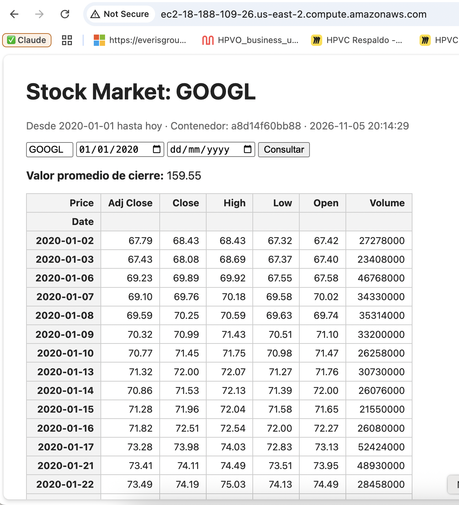
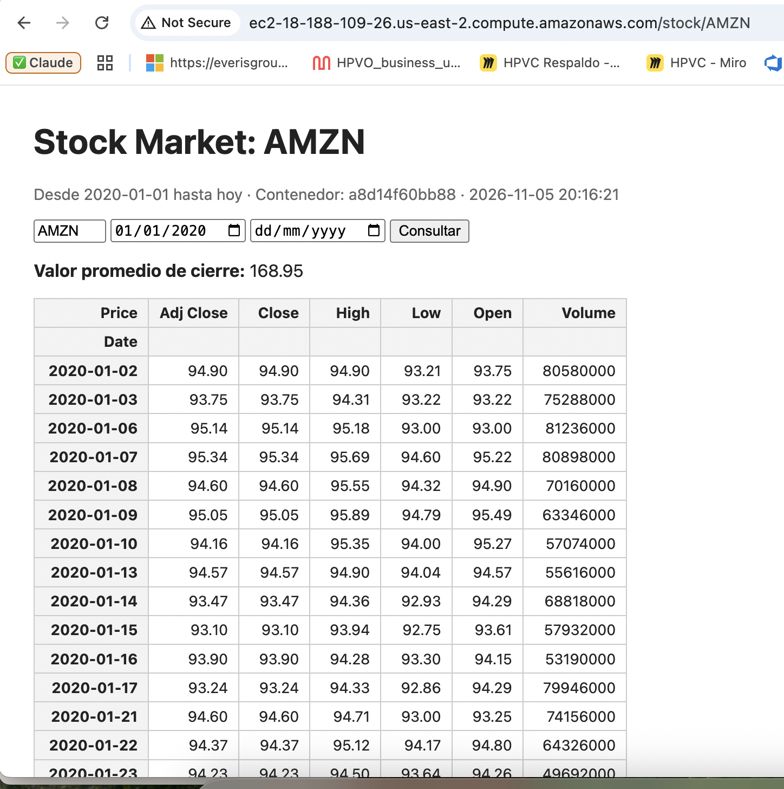

# Taller 01 – Despliegue de Servicios de Red

Solución del taller *Despliegue de Servicios de Red* (Computación distribuida y
Frameworks para desarrollo de Aplicaciones Inteligentes).

El script de Yahoo Finance se expone como **web service con Flask**, se
empaqueta en un **contenedor Docker**, se publica en **Docker Hub** y se
despliega en una **máquina virtual EC2 (Ubuntu) de AWS**, accesible desde
cualquier parte del mundo por HTTP.

**Demostración:** http://ec2-18-188-109-26.us-east-2.compute.amazonaws.com
· **Imagen:** [`cartovarc/stock-market:2.0`](https://hub.docker.com/r/cartovarc/stock-market)
· **Evidencias:** [ver capturas](#5-evidencia)

## De proceso a servicio de red

Un **proceso** es un programa en ejecución: tiene su propio espacio de memoria,
sus recursos (archivos abiertos, hilos) y es administrado por el sistema
operativo. El script `read_value_yf.py` ejecutado desde la consola es un proceso:
recibe argumentos, hace su trabajo, imprime el resultado y termina. Solo quien
está en la misma máquina puede usarlo.

Ese proceso se convierte en un **servicio de red** cuando, en lugar de terminar,
queda **escuchando en un puerto** (un *socket* TCP) y atiende peticiones que
llegan a través de la red siguiendo un protocolo acordado (aquí **HTTP**).
Flask hace exactamente eso: asocia funciones de Python a rutas HTTP
(`@app.route("/")`) y el servidor (gunicorn) mantiene el proceso vivo en el
puerto 5000 esperando clientes. Cualquier cliente —un navegador o otro
programa— que conozca la dirección y el puerto puede pedirle que ejecute la tarea.

```
 (a) Proceso local                          (b) Servicio de red
 ─────────────────                          ───────────────────
 Usuario                                    Cliente (navegador / programa)
   │ python3 read_value_yf.py AMZN             │  GET /stock/AMZN  (HTTP)
   ▼                                           ▼
 ┌──────────────────────┐                   ═══════ Red / Internet ═══════
 │ Proceso              │                      │
 │  read_value_yf.py    │                      ▼  puerto 80 (EC2) → 5000 (contenedor)
 │  - memoria, CPU      │                   ┌──────────────────────────────────┐
 │  - stdin / stdout    │                   │ Proceso servidor (gunicorn+Flask)│
 └─────────┬────────────┘                   │  escucha en 0.0.0.0:5000 (socket)│
           │ imprime y termina              │  ruta "/stock/<ticker>"          │
           ▼                                │      └─► read_value_yf.py        │
 Resultado en la consola                    └───────────────┬──────────────────┘
                                                            │ responde HTML (200 OK)
                                                            ▼
                                            Cliente recibe la tabla y el promedio
                                            (el proceso sigue vivo esperando más)
```

Al empaquetarlo en un **contenedor Docker**, el proceso servidor viaja junto con
sus librerías (Flask, yfinance, pandas) y se ejecuta igual en cualquier máquina
con Docker, como la EC2 de AWS.

## Arquitectura

```
 Equipo local                       Docker Hub                 AWS EC2 (Ubuntu, "demo_docker")
 ────────────                       ──────────                 ───────────────────────────────
 Dockerfile ──docker build──► <usuario>/stock-market:2.0 ──docker pull──► contenedor stock-market
                     docker push                                       Flask/gunicorn :5000
                                                                              ▲   │
 Navegador ─────── http://<DNS público de la EC2>  (puerto 80 ─► 5000) ───────┘   ▼
                                                                          Yahoo Finance
```

## Estructura del repositorio

```
.
├── read_value_yf.py     # Script del taller: descarga datos de un stock y calcula el promedio
├── app.py               # Web service Flask que expone el script por HTTP
├── requirements.txt     # flask, gunicorn, yfinance
├── Dockerfile           # Imagen del web service  -> stock-market:2.0
├── Dockerfile.cli       # Imagen del script por consola -> stock-market:1.0
├── .dockerignore
├── scripts/
│   └── setup_ec2.sh     # Acondiciona la EC2: instala Docker y ejecuta el contenedor
└── evidencias/          # Capturas de pantalla del servicio funcionando en la nube
```

## Endpoints

| Ruta | Descripción |
|------|-------------|
| `/` | Datos de GOOGL desde 2020-01-01 y su valor promedio (igual que el taller) |
| `/stock/AMZN` | Otro ticker |
| `/stock/AMZN?start=2024-01-01&end=2024-12-31` | Rango de fechas |
| `/health` | Chequeo de salud (JSON) |

---

## 1. Ejecución local sin Docker (opcional)

```bash
python3 -m venv .venv
source .venv/bin/activate
pip install -r requirements.txt

python read_value_yf.py AMZN     # script por consola
python app.py                    # web service en http://localhost:5000
```

## 2. Contenerización con Docker

### 2.1 Imagen del script (stock-market:1.0)

```bash
docker image build -f Dockerfile.cli -t stock-market:1.0 .
docker container run --rm stock-market:1.0                 # GOOGL
docker container run --rm -e STOCK=AMZN stock-market:1.0   # AMZN
```

### 2.2 Imagen del web service (stock-market:2.0)

```bash
docker image build -t stock-market:2.0 .
docker container run --rm --name stock-market -p 5000:5000 stock-market:2.0
```

Abrir http://localhost:5000

> **macOS:** el puerto 5000 lo usa el *Receptor AirPlay*. Si aparece
> `address already in use`, usar `-p 5001:5000` y abrir http://localhost:5001.

## 3. Publicación en Docker Hub

> **Importante en Mac con chip Apple (M1/M2/M3/M4):** la imagen debe
> construirse para `linux/amd64`, que es la arquitectura de las instancias
> `t2.micro`/`t3.micro`. Si no, en la EC2 aparecerá `exec format error`.

```bash
docker login
docker buildx build --platform linux/amd64 -t cartovarc/stock-market:2.0 --push .
```

(En un equipo Intel/AMD basta con `docker image tag stock-market:2.0 cartovarc/stock-market:2.0`
y `docker image push cartovarc/stock-market:2.0`, como indica el taller.)

## 4. Despliegue en AWS EC2

1. Consola de AWS → **EC2** → **Launch instance**.
2. Nombre `demo_docker`, AMI **Ubuntu** (Free tier eligible), tipo `t2.micro` o `t3.micro`.
3. Key pair nuevo `demo_docker` (RSA, `.pem`) → se descarga `demo_docker.pem`.
4. Network settings: marcar **Allow SSH traffic** y **Allow HTTP traffic from the internet**.
5. **Launch instance**.
6. Conectarse por SSH:

   ```bash
   chmod 400 demo_docker.pem
   ssh -i demo_docker.pem ubuntu@<DNS_publico_de_la_instancia>
   ```

7. Acondicionar la máquina (instalar Docker, habilitar al usuario `ubuntu`,
   descargar y ejecutar el contenedor):

   ```bash
   curl -fsSLO https://raw.githubusercontent.com/cartovarc/taller1-despliegue-servicios/main/scripts/setup_ec2.sh
   bash setup_ec2.sh cartovarc
   ```

   El contenedor queda publicado en el puerto **80** del host (`-p 80:5000`).

8. Abrir en el navegador `http://<DNS_publico_de_la_instancia>`.

## 5. Evidencia

Servicio desplegado en una EC2 Ubuntu (us-east-2) y accesible públicamente en
http://ec2-18-188-109-26.us-east-2.compute.amazonaws.com

**`/` – GOOGL desde 2020-01-01 (valor promedio de cierre 159.55)**



**`/stock/AMZN` – AMZN desde 2020-01-01 (valor promedio de cierre 168.95)**



## 6. Apagar la máquina virtual (MUY IMPORTANTE)

EC2 → **Instances** → seleccionar `demo_docker` → **Instance state** →
**Terminate instance** → confirmar. Así AWS no cobra por los recursos.

## Notas

* `read_value_yf.py` aplana las columnas MultiIndex que devuelven las versiones
  recientes de `yfinance`, y calcula la fecha final en cada llamada (no al importar).
* Yahoo Finance a veces limita peticiones desde IPs de nube. Si la página
  muestra un error o "No se encontraron datos", esperar un momento y recargar.
* Los archivos `.pem` están en `.gitignore`: **nunca** subir la llave al repositorio.
